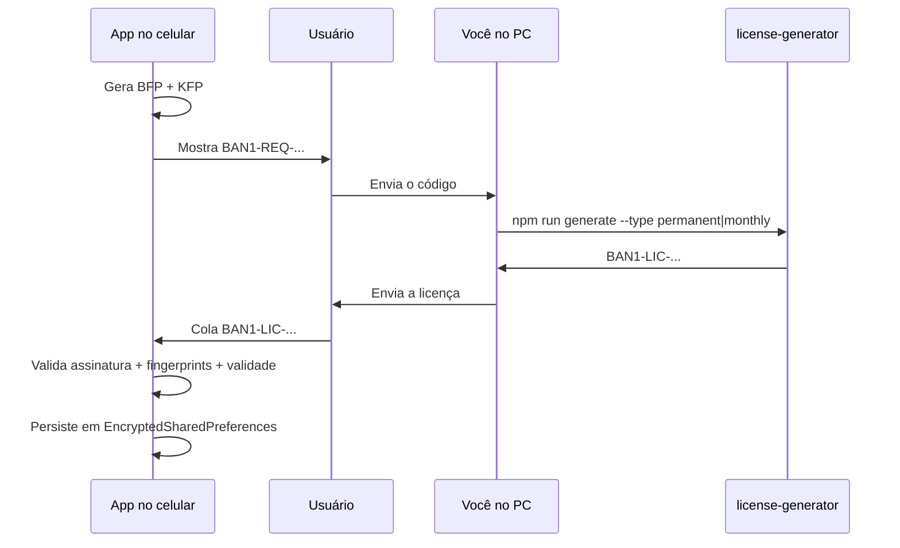

# Ativação offline Banavita

Controle de acesso por dispositivo, sem servidor, usando fingerprint + Android Keystore + licença assinada RSA (SHA256withRSA).

Objetivo: impedir que um APK compartilhado seja usado livremente em outro celular. Cada aparelho gera um código único; só uma licença assinada por você libera aquele aparelho.

## Guia rápido: testar no celular

Use este fluxo na primeira vez (ou após regenerar chaves):

### 1. Gerar par de chaves (uma vez no PC)

```bash
cd tools/license-generator
npm run generate-keys
```

Isso cria `keys/private.pem` (só no seu PC) e **atualiza** a chave pública em `app/.../LicenseConstants.kt`.  
**Depois disso, gere o APK de novo** — o app precisa da mesma chave pública que o gerador usa para assinar.

> Se você já tem `private.pem` de antes, **não** rode `generate-keys` de novo (invalida licenças antigas). Só gere a licença com a chave existente.

### 2. Instalar o APK no celular

Instale o build debug ou release (Android Studio -> Run, ou `assembleDebug`).

### 3. Copiar o código do aparelho

1. Abra o app -> tela **Liberação do aplicativo**
2. Toque no ícone de **copiar** ao lado do código `BAN1-REQ-...`
3. Envie para o PC (WhatsApp, e-mail, etc.)

### 4. Gerar a licença no PC

```bash
cd tools/license-generator
npm run generate -- --request "BAN1-REQ-COLE_AQUI" --type permanent
```

Para testes, use `permanent`. Para assinatura mensal:

```bash
npm run generate -- --request "BAN1-REQ-..." --type monthly
```

A saída é um token `BAN1-LIC-...` (pode ser longo — copie inteiro).

### 5. Ativar no celular

1. Cole o `BAN1-LIC-...` no campo **Licença**
2. Toque em **Liberar aplicativo**
3. Se ok, o app abre a tela principal

### Problemas comuns

| Sintoma | Causa provável | Solução |
|---------|----------------|---------|
| Assinatura inválida | Chave pública do APK ≠ par da `private.pem` | Rode `generate-keys`, rebuild do APK, gere licença de novo |
| Dispositivo não corresponde | Licença de outro celular | Gere com o `BAN1-REQ-...` **deste** aparelho |
| Licença expirada | Tipo `monthly` após 30 dias | Gere nova licença ou use `permanent` em testes |
| Factory reset | `ANDROID_ID` mudou | Novo `BAN1-REQ-...` -> nova licença |

## Fluxo operacional



1. O app gera um **código de solicitação** (`BAN1-REQ-...`).
2. O usuário envia esse código para você (WhatsApp, etc.).
3. Você gera uma **licença** (`BAN1-LIC-...`) no PC com a chave privada.
4. O usuário cola a licença no app (tela de ativação).
5. O app valida e, se ok, libera o uso.

## Fingerprints do dispositivo

O aparelho é identificado por **dois** hashes hexadecimais SHA-256:

| Sigla | Origem | Como é calculado |
|-------|--------|------------------|
| **BFP** | Base | `SHA-256(ANDROID_ID + "|" + packageName + "|" + salt)` |
| **KFP** | Keystore | `SHA-256(chave pública EC secp256r1)` gerada/armazenada no Android Keystore |

- **Salt** embutido: `Banavita_Offline_v1_Salt_2026` (`LicenseConstants.APP_SALT`).
- **Package name:** `br.com.banavita.app`.
- **Alias Keystore:** `banavita_activation_key_v1`.
- Flag **`hardwareBacked`:** indica se a chave EC está em hardware seguro (quando o aparelho permite).

### Comportamentos importantes

| Evento | Efeito |
|--------|--------|
| Reinstalar o mesmo APK (mesma assinatura) | Em geral **mantém** `ANDROID_ID` e a chave do Keystore -> mesma licença continua válida |
| Factory reset | `ANDROID_ID` muda -> **nova licença** necessária |
| Licença de outro celular | Falha com `DeviceMismatchException` |
| Keystore indisponível / falha | Em aparelhos reais o Keystore deve funcionar; testes usam fakes |

## Tipos de licença

| Tipo | Comportamento |
|------|----------------|
| `PERMANENT` | Sem expiração após ativação |
| `MONTHLY` | Expira **30 dias** após a **primeira ativação** no aparelho (`30 * 24 * 60 * 60 * 1000` ms) |

A data de expiração mensal **não** é gravada na geração da licença. O app calcula:

```
expiresAt = activatedAt + MONTHLY_DURATION_MILLIS
```

Se o usuário reativar com a **mesma** licença mensal já salva, o `activatedAt` original é **preservado** (não reinicia a contagem).

## Formatos de token

### Código de solicitação (`BAN1-REQ-`)

```
BAN1-REQ-<base64url(JSON)>
```

JSON interno (UTF-8 -> Base64 URL-safe, sem padding):

```json
{
  "v": 1,
  "bfp": "<hex SHA-256>",
  "kfp": "<hex SHA-256>",
  "hw": true
}
```

| Campo | Significado |
|-------|-------------|
| `v` | Versão do protocolo (`1`) |
| `bfp` | Fingerprint base |
| `kfp` | Fingerprint Keystore |
| `hw` | Keystore hardware-backed |

### Licença (`BAN1-LIC-`)

Mensagem canônica assinada (UTF-8):

```
v1|bfp=<hex>|kfp=<hex>|type=PERMANENT
v1|bfp=<hex>|kfp=<hex>|type=MONTHLY
```

Token final:

```
BAN1-LIC-<base64url(canonical)>.<base64url(assinatura_RSA_SHA256)>
```

- Algoritmo de assinatura: `SHA256withRSA`
- Chave privada: só no PC (`tools/license-generator/keys/private.pem`)
- Chave pública: embutida em `LicenseConstants.PUBLIC_KEY_PEM`

## Validação no app (ordem)

`LicenseValidator.validateLicenseToken(...)` executa nesta ordem:

1. Parse do prefixo `BAN1-LIC-` e split `payload.signature`
2. Verificação da assinatura RSA com a chave pública
3. Comparação de `bfp` e `kfp` com o fingerprint **atual** do aparelho
4. Cálculo de `expiresAt` (se `MONTHLY`)
5. Se `now > expiresAt` -> `LicenseExpiredException`

## Persistência local

Arquivo de prefs criptografado: `banavita_activation_secure`  
(`EncryptedSharedPreferences` + `MasterKey` AES256-GCM)

| Chave | Conteúdo |
|-------|----------|
| `license_token` | Token `BAN1-LIC-...` completo |
| `license_type` | `PERMANENT` ou `MONTHLY` |
| `activated_at` | Epoch millis da primeira ativação |
| `hardware_backed` | Boolean do Keystore no momento da ativação |

A ativação **não** fica no Room/SQLite — fica em prefs criptografadas, separada do banco de negócio.

## API do backend (`ActivationRepository`)

Ponto de entrada para a UI futura:

| Método | Retorno | Uso |
|--------|---------|-----|
| `buildActivationRequest()` | `ActivationRequest` | Exibir/copiar o código `BAN1-REQ-...` |
| `activate(licenseToken)` | `ActivationStatus` | Validar, persistir e liberar o app |
| `getActivationStatus(now?)` | `ActivationStatus` | Status atual (revalida assinatura/expiração) |
| `isActivated(now?)` | `Boolean` | Gate de navegação (`MainActivity`) |
| `clearActivation()` | `Unit` | Debug/suporte: remove a licença local |

### Modelos de domínio

```kotlin
data class ActivationRequest(
    val requestCode: String,
    val baseFingerprintHex: String,
    val keystoreFingerprintHex: String,
    val hardwareBacked: Boolean,
)

data class ActivationStatus(
    val isActivated: Boolean,
    val licenseType: LicenseType?,          // null se inativo
    val activatedAtEpochMillis: Long?,
    val expiresAtEpochMillis: Long?,        // null se PERMANENT ou inativo
    val hardwareBacked: Boolean,
)
```

### Comportamento de `getActivationStatus`

- Sem dados salvos -> `isActivated = false`
- Licença inválida, expirada ou de outro device -> trata como **inativo** (não propaga a exceção nessa leitura)
- `activate(...)` **propaga** as exceções para a UI poder mostrar erro

## Exceções

Hierarquia: `BanavitaDomainException` -> `ActivationException` -> variantes abaixo.

| Exceção | Quando |
|---------|--------|
| `InvalidLicenseException` | Prefixo/formato errado, payload corrompido, assinatura inválida |
| `DeviceMismatchException` | `bfp` ou `kfp` da licença ≠ fingerprint atual |
| `LicenseExpiredException` | Licença `MONTHLY` após 30 dias da ativação |

## Componentes Android

| Classe / arquivo | Pacote | Responsabilidade |
|------------------|--------|------------------|
| `AndroidDeviceFingerprintProvider` | `core.security` | Calcula BFP (ANDROID_ID + package + salt) |
| `AndroidDeviceKeystoreManager` | `core.security` | Cria/lê chave EC e calcula KFP |
| `LicenseCodec` | `core.security` | Monta/parseia `BAN1-REQ` e `BAN1-LIC` |
| `LicenseValidator` | `core.security` | Assinatura + match + expiração |
| `LicenseConstants` | `core.security` | Prefixos, salt, duração, chave pública |
| `LicensePublicKeyProvider` | `core.security` | Carrega PEM pública |
| `ActivationLocalDataSource` | `data.local.activation` | EncryptedSharedPreferences |
| `ActivationRepository` | `data.repository` | API de backend |
| `SecurityModule` | `di` | Binds Hilt das interfaces de segurança |

## Gerador no PC (`tools/license-generator`)

Documentação operacional: [tools/license-generator/README.md](../../tools/license-generator/README.md)

### Setup (uma vez)

```bash
cd tools/license-generator
npm run generate-keys
```

Gera `keys/private.pem` (gitignored) e `keys/public.pem`, e sincroniza a pública em `LicenseConstants.kt`.

### Gerar licenças

```bash
# Permanente
npm run generate -- --request "BAN1-REQ-..." --type permanent

# Mensal (30 dias após ativação no celular)
npm run generate -- --request "BAN1-REQ-..." --type monthly

# Manual (sem request code)
npm run generate -- --bfp <hex> --kfp <hex> --type permanent

# Salvar em arquivo
npm run generate -- --request "BAN1-REQ-..." --type monthly --output licenca.txt
```

Aliases de tipo aceitos: `permanent`/`permanente`, `monthly`/`mensal`/`1month`.

### Segurança das chaves

- **Privada:** nunca no APK, nunca no git.
- **Pública:** só a pública vai no app.
- Regenerar chaves antes da primeira release pública invalida licenças antigas -> exige novo APK.

## Limitações honestas

| Risco | Realidade |
|-------|-----------|
| Engenharia reversa | Alguém determinado pode remover o check no APK. R8/ProGuard dificulta, não impede 100%. |
| Root | Pode tentar falsificar prefs/fingerprint. |
| Objetivo realista | Bloquear uso casual do APK compartilhado — não é DRM militar. |

## UI de ativação

Implementada em `ui/activation/`:

- Exibe e copia o código `BAN1-REQ-...`
- Campo para colar `BAN1-LIC-...` e botão **Liberar aplicativo**
- Gate em `BanavitaApp`: se `!isActivated()` -> só tela de ativação
- Erros mapeados para mensagens na tela (assinatura, dispositivo, expiração)

Mockup: `docs/ui/mockups/activation.png`

## Testes relacionados

| Teste | O que cobre |
|-------|-------------|
| `LicenseCodecTest` | Roundtrip do `BAN1-REQ` |
| `LicenseValidatorTest` | Assinatura, mismatch, expiração mensal |
| `ActivationRepositoryTest` | Persistência permanente/mensal (Robolectric) |
