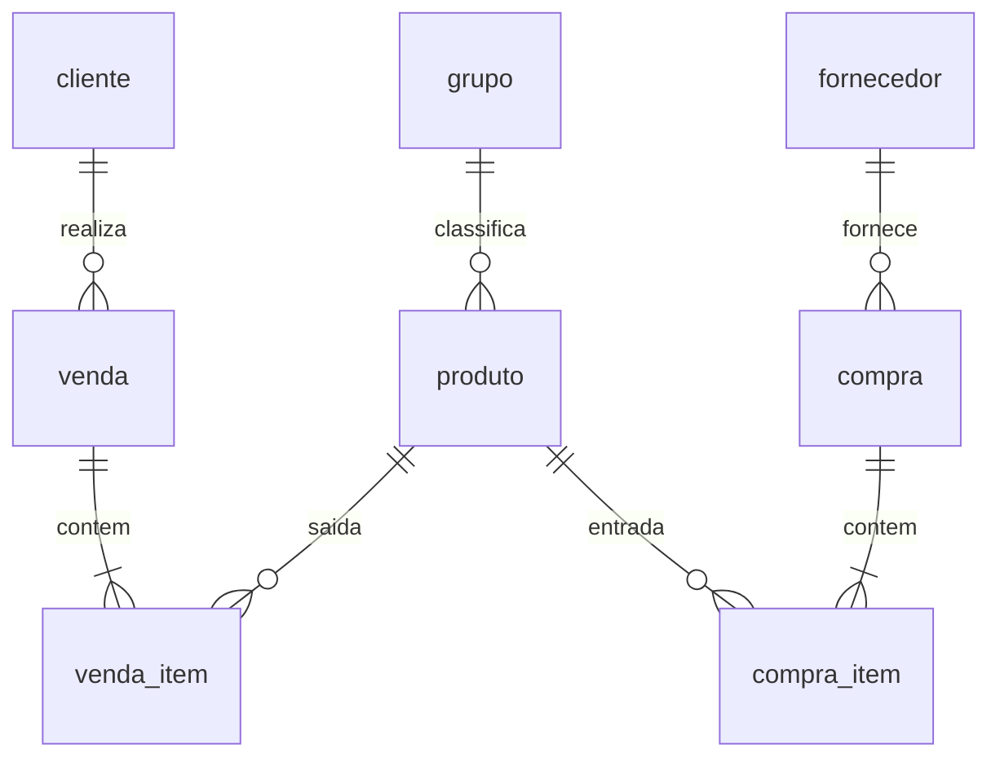

# Banco de dados Banavita (SQLite / Room)

Documentação da camada de persistência offline do aplicativo Banavita.

## Visão geral

- **Motor:** SQLite via Room ORM (KSP)
- **Arquivo:** `banavita.db`
- **Versão do schema:** 1
- **Estratégia de delete:** hard delete (sem `deleted_at`)
- **Identificadores:** UUID (`TEXT`, 36 caracteres)
- **Datas:** epoch millis (`INTEGER`)
- **Valores monetários:** centavos (`INTEGER`)
- **Quantidades:** `REAL` (suporta kg, unidades fracionadas)

## Diagrama relacional



## Tabelas

### `grupo`

| Coluna | Tipo | Restrições |
|--------|------|------------|
| GRU_ID | TEXT | PK |
| created_at | INTEGER | NOT NULL |
| updated_at | INTEGER | NOT NULL |
| GRU_NOME | TEXT | NOT NULL |
| GRU_OBS | TEXT | NULL |

### `produto`

| Coluna | Tipo | Restrições |
|--------|------|------------|
| PRO_ID | TEXT | PK |
| created_at | INTEGER | NOT NULL |
| updated_at | INTEGER | NOT NULL |
| PRO_DESCRICAO | TEXT | NOT NULL |
| PRO_PRECO | INTEGER | NOT NULL (centavos, preço padrão de venda) |
| PRO_GRUPO | TEXT | NULL, FK → grupo.GRU_ID (RESTRICT) |
| PRO_UNIDADE | TEXT | NOT NULL, default `UN` |

Índice: `PRO_GRUPO`

### `cliente`

| Coluna | Tipo | Restrições |
|--------|------|------------|
| CLI_ID | TEXT | PK |
| created_at | INTEGER | NOT NULL |
| updated_at | INTEGER | NOT NULL |
| CLI_NOME | TEXT | NOT NULL |
| CLI_TELEFONE | TEXT | NULL (validar até 14 chars na camada de domínio) |

### `fornecedor`

| Coluna | Tipo | Restrições |
|--------|------|------------|
| FOR_ID | TEXT | PK |
| created_at | INTEGER | NOT NULL |
| updated_at | INTEGER | NOT NULL |
| FOR_NOME | TEXT | NOT NULL |
| FOR_TELEFONE | TEXT | NULL |

### `venda` (cabeçalho)

| Coluna | Tipo | Restrições |
|--------|------|------------|
| VEN_ID | TEXT | PK |
| created_at | INTEGER | NOT NULL |
| updated_at | INTEGER | NOT NULL |
| VEN_DATA | INTEGER | NOT NULL |
| VEN_CLIENTE | TEXT | NULL, FK → cliente.CLI_ID (RESTRICT) |
| VEN_VLRTOT | INTEGER | NOT NULL (snapshot da soma dos itens) |

Índices: `VEN_DATA`, `VEN_CLIENTE`

### `venda_item`

| Coluna | Tipo | Restrições |
|--------|------|------------|
| VEI_ID | TEXT | PK |
| created_at | INTEGER | NOT NULL |
| updated_at | INTEGER | NOT NULL |
| VEI_VENDA | TEXT | NOT NULL, FK → venda.VEN_ID (CASCADE) |
| VEI_PRODUTO | TEXT | NOT NULL, FK → produto.PRO_ID (RESTRICT) |
| VEI_VLRUN | INTEGER | NOT NULL (snapshot) |
| VEI_QTDE | REAL | NOT NULL, > 0 |
| VEI_VLRTOT | INTEGER | NOT NULL |

Índices: `VEI_VENDA`, `VEI_PRODUTO`

### `compra` (cabeçalho)

| Coluna | Tipo | Restrições |
|--------|------|------------|
| COM_ID | TEXT | PK |
| created_at | INTEGER | NOT NULL |
| updated_at | INTEGER | NOT NULL |
| COM_DATA | INTEGER | NOT NULL |
| COM_FORNECEDOR | TEXT | NULL, FK → fornecedor.FOR_ID (RESTRICT) |
| COM_VLRTOT | INTEGER | NOT NULL |

Índices: `COM_DATA`, `COM_FORNECEDOR`

### `compra_item`

| Coluna | Tipo | Restrições |
|--------|------|------------|
| COI_ID | TEXT | PK |
| created_at | INTEGER | NOT NULL |
| updated_at | INTEGER | NOT NULL |
| COI_COMPRA | TEXT | NOT NULL, FK → compra.COM_ID (CASCADE) |
| COI_PRODUTO | TEXT | NOT NULL, FK → produto.PRO_ID (RESTRICT) |
| COI_VLRUN | INTEGER | NOT NULL |
| COI_QTDE | REAL | NOT NULL, > 0 |
| COI_VLRTOT | INTEGER | NOT NULL |

Índices: `COI_COMPRA`, `COI_PRODUTO`

## View de estoque

### `vw_produto_estoque`

Saldo calculado por produto:

```
saldo = SUM(compra_item.COI_QTDE) - SUM(venda_item.VEI_QTDE)
```

Não há coluna de estoque em `produto`. A view é a fonte da verdade para saldo.

## Regras de negócio (backend)

1. **Venda/compra = documento + itens.** Cada operação grava cabeçalho e N itens em transação Room.
2. **Preço snapshot.** Itens guardam `VLRUN`/`VLRTOT` no momento da operação; alterações futuras em `PRO_PRECO` não retroagem.
3. **Estoque.** Venda valida saldo disponível antes de gravar. Estoque negativo não é permitido nesta versão.
4. **Hard delete.**
   - Venda/compra: delete remove cabeçalho; itens caem por CASCADE.
   - Produto/grupo/cliente/fornecedor: delete bloqueado se houver referências (COUNT no repositório + FK RESTRICT).
5. **Auditoria.** `created_at` imutável; `updated_at` atualizado pelo repositório a cada alteração.

## Pacotes Kotlin

| Camada | Pacote |
|--------|--------|
| Entidades Room | `br.com.banavita.app.data.local.entity` |
| DAOs | `br.com.banavita.app.data.local.dao` |
| Database | `br.com.banavita.app.data.local.BanavitaDatabase` |
| Repositórios | `br.com.banavita.app.data.repository` |
| Modelos de domínio | `br.com.banavita.app.domain.model` |
| Dinheiro | `br.com.banavita.app.core.money.Money` |

## Schema exportado

O Room exporta o schema JSON em `app/schemas/` quando o projeto compila (KSP `room.schemaLocation`).
