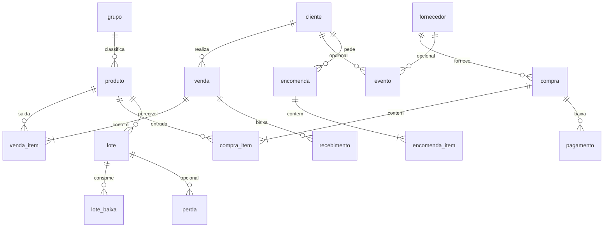

# Banco de dados Banavita (SQLite / Room)

Documentação da camada de persistência offline do aplicativo Banavita.

## Visão geral

- **Motor:** SQLite via Room ORM (KSP)
- **Arquivo:** `banavita.db`
- **Versão do schema:** 4
- **Migrações:** `MIGRATION_1_2` (financeiro), `MIGRATION_2_3` (agenda) e `MIGRATION_3_4` (perecíveis: lote, câmara, perda, queima, encomenda). Sem `fallbackToDestructiveMigration`.
- **Estratégia de delete:** hard delete (sem `deleted_at`)
- **Identificadores:** UUID (`TEXT`, 36 caracteres)
- **Datas:** epoch millis (`INTEGER`)
- **Valores monetários:** centavos (`INTEGER`)
- **Quantidades:** `REAL` (suporta kg, unidades fracionadas)

## Diagrama relacional

## Tabelas

### `grupo`

| Coluna | Tipo | Restrições |
|--------|------|------------|
| GRU_ID | TEXT | PK |
| created_at | INTEGER | NOT NULL |
| updated_at | INTEGER | NOT NULL |
| GRU_NOME | TEXT | NOT NULL |
| GRU_OBS | TEXT | NULL |

### `produto`

| Coluna | Tipo | Restrições |
|--------|------|------------|
| PRO_ID | TEXT | PK |
| created_at | INTEGER | NOT NULL |
| updated_at | INTEGER | NOT NULL |
| PRO_DESCRICAO | TEXT | NOT NULL |
| PRO_PRECO | INTEGER | NOT NULL (centavos, preço padrão de venda) |
| PRO_GRUPO | TEXT | NULL, FK -> grupo.GRU_ID (RESTRICT) |
| PRO_UNIDADE | TEXT | NOT NULL, default `UN` |
| PRO_PERECIVEL | INTEGER | NOT NULL, default 0 (schema v4) |
| PRO_DIAS_VERDE | INTEGER | NOT NULL, default 3 |
| PRO_DIAS_VERDOLENGA | INTEGER | NOT NULL, default 2 |
| PRO_DIAS_AMARELA | INTEGER | NOT NULL, default 2 |
| PRO_DIAS_PINTADA | INTEGER | NOT NULL, default 2 |
| PRO_PRECO_VERDE | INTEGER | NOT NULL (centavos) |
| PRO_PRECO_VERDOLENGA | INTEGER | NOT NULL |
| PRO_PRECO_AMARELA | INTEGER | NOT NULL |
| PRO_PRECO_PINTADA | INTEGER | NOT NULL |
| PRO_PRECO_PODRE | INTEGER | NOT NULL, default 0 |

Produto já cadastrado na v3 nasce `PRO_PERECIVEL = 0`. Curva e preços por estado só valem se perecível. Podre não se vende (preço 0).

Índice: `PRO_GRUPO`

### `cliente`

| Coluna | Tipo | Restrições |
|--------|------|------------|
| CLI_ID | TEXT | PK |
| created_at | INTEGER | NOT NULL |
| updated_at | INTEGER | NOT NULL |
| CLI_NOME | TEXT | NOT NULL |
| CLI_TELEFONE | TEXT | NULL (validar até 14 chars na camada de domínio) |
| CLI_PONTO_PREF | TEXT | NULL (schema v4: VERDE/VERDOLENGA/AMARELA/PINTADA/PODRE) |

### `fornecedor`

| Coluna | Tipo | Restrições |
|--------|------|------------|
| FOR_ID | TEXT | PK |
| created_at | INTEGER | NOT NULL |
| updated_at | INTEGER | NOT NULL |
| FOR_NOME | TEXT | NOT NULL |
| FOR_TELEFONE | TEXT | NULL |

### `venda` (cabeçalho)

| Coluna | Tipo | Restrições |
|--------|------|------------|
| VEN_ID | TEXT | PK |
| created_at | INTEGER | NOT NULL |
| updated_at | INTEGER | NOT NULL |
| VEN_DATA | INTEGER | NOT NULL |
| VEN_CLIENTE | TEXT | NULL, FK -> cliente.CLI_ID (RESTRICT) |
| VEN_VLRTOT | INTEGER | NOT NULL (snapshot da soma dos itens) |
| VEN_PRAZO | INTEGER | NOT NULL, default 0 (0 = à vista, 1 = a prazo) |

Índices: `VEN_DATA`, `VEN_CLIENTE`

### `venda_item`

| Coluna | Tipo | Restrições |
|--------|------|------------|
| VEI_ID | TEXT | PK |
| created_at | INTEGER | NOT NULL |
| updated_at | INTEGER | NOT NULL |
| VEI_VENDA | TEXT | NOT NULL, FK -> venda.VEN_ID (CASCADE) |
| VEI_PRODUTO | TEXT | NOT NULL, FK -> produto.PRO_ID (RESTRICT) |
| VEI_VLRUN | INTEGER | NOT NULL (snapshot) |
| VEI_QTDE | REAL | NOT NULL, > 0 |
| VEI_VLRTOT | INTEGER | NOT NULL |
| VEI_ESTADO | TEXT | NULL (schema v4; obrigatório na venda se o produto for perecível) |

Índices: `VEI_VENDA`, `VEI_PRODUTO`

### `compra` (cabeçalho)

| Coluna | Tipo | Restrições |
|--------|------|------------|
| COM_ID | TEXT | PK |
| created_at | INTEGER | NOT NULL |
| updated_at | INTEGER | NOT NULL |
| COM_DATA | INTEGER | NOT NULL |
| COM_FORNECEDOR | TEXT | NULL, FK -> fornecedor.FOR_ID (RESTRICT) |
| COM_VLRTOT | INTEGER | NOT NULL |
| COM_PRAZO | INTEGER | NOT NULL, default 0 (0 = à vista, 1 = a prazo) |

Índices: `COM_DATA`, `COM_FORNECEDOR`

### `compra_item`

| Coluna | Tipo | Restrições |
|--------|------|------------|
| COI_ID | TEXT | PK |
| created_at | INTEGER | NOT NULL |
| updated_at | INTEGER | NOT NULL |
| COI_COMPRA | TEXT | NOT NULL, FK -> compra.COM_ID (CASCADE) |
| COI_PRODUTO | TEXT | NOT NULL, FK -> produto.PRO_ID (RESTRICT) |
| COI_VLRUN | INTEGER | NOT NULL |
| COI_QTDE | REAL | NOT NULL, > 0 |
| COI_VLRTOT | INTEGER | NOT NULL |

Índices: `COI_COMPRA`, `COI_PRODUTO`

### `recebimento` (schema v2)

| Coluna | Tipo | Restrições |
|--------|------|------------|
| REC_ID | TEXT | PK |
| created_at | INTEGER | NOT NULL |
| updated_at | INTEGER | NOT NULL |
| REC_VENDA | TEXT | NOT NULL, FK -> venda.VEN_ID (CASCADE) |
| REC_DATA | INTEGER | NOT NULL |
| REC_VALOR | INTEGER | NOT NULL, > 0 |

À vista: o create da venda grava uma baixa do total. A prazo: saldo = total − SUM(recebimentos).

### `pagamento` (schema v2)

| Coluna | Tipo | Restrições |
|--------|------|------------|
| PAG_ID | TEXT | PK |
| created_at | INTEGER | NOT NULL |
| updated_at | INTEGER | NOT NULL |
| PAG_COMPRA | TEXT | NOT NULL, FK -> compra.COM_ID (CASCADE) |
| PAG_DATA | INTEGER | NOT NULL |
| PAG_VALOR | INTEGER | NOT NULL, > 0 |

### `evento` (schema v3)

| Coluna | Tipo | Restrições |
|--------|------|------------|
| EVE_ID | TEXT | PK |
| created_at | INTEGER | NOT NULL |
| updated_at | INTEGER | NOT NULL |
| EVE_TITULO | TEXT | NOT NULL |
| EVE_DATAHORA | INTEGER | NOT NULL |
| EVE_OBS | TEXT | NULL |
| EVE_CLIENTE | TEXT | NULL, FK -> cliente (RESTRICT) |
| EVE_FORNECEDOR | TEXT | NULL, FK -> fornecedor (RESTRICT) |
| EVE_NOTIFICAR | INTEGER | NOT NULL, default 1 |
| EVE_ANTECIPACAO_MIN | INTEGER | NULL (15, 60 ou 1440) |
| EVE_NOTIF_TITULO | TEXT | NULL |
| EVE_NOTIF_CORPO | TEXT | NULL |

Não vincular cliente e fornecedor ao mesmo tempo (regra no repositório).

### `lote` (schema v4)

Quantidade restante de uma compra perecível (ou fatia transferida). Estado é do lote, não do produto.

| Coluna | Tipo | Restrições |
|--------|------|------------|
| LOT_ID | TEXT | PK |
| created_at | INTEGER | NOT NULL |
| updated_at | INTEGER | NOT NULL |
| LOT_PRODUTO | TEXT | NOT NULL, FK -> produto (RESTRICT) |
| LOT_COMPRA | TEXT | NULL, FK -> compra (SET NULL) |
| LOT_COMPRA_ITEM | TEXT | NULL |
| LOT_ORIGEM | TEXT | NULL (lote pai na transferência fria→etileno) |
| LOT_DATA | INTEGER | NOT NULL (data da compra / entrada) |
| LOT_QTDE_INICIAL | REAL | NOT NULL |
| LOT_QTDE_RESTANTE | REAL | NOT NULL |
| LOT_CAMARA | TEXT | NOT NULL (`FRIA` ou `ETILENO`) |
| LOT_ESTADO | TEXT | NOT NULL (`VERDE` … `PODRE`) |
| LOT_ETAPA_INICIO_DAY | INTEGER | NULL (epoch day local; relógio só na etileno) |
| LOT_CUSTO_UN | INTEGER | NOT NULL (snapshot do custo da compra, centavos/kg) |
| LOT_ROTULO | TEXT | NOT NULL (variedade + data [+#n]) |

Compra de perecível cria lote **verde na fria**, `LOT_ETAPA_INICIO_DAY` nulo (relógio parado). Transferência parcial: o pai reduz `LOT_QTDE_RESTANTE`; o filho nasce na etileno, verde, relógio = hoje local, `LOT_ORIGEM` = pai.

### `lote_baixa` (schema v4)

Rastro FIFO de venda ou perda.

| Coluna | Tipo | Restrições |
|--------|------|------------|
| LBA_ID | TEXT | PK |
| created_at | INTEGER | NOT NULL |
| LBA_LOTE | TEXT | NOT NULL, FK -> lote (RESTRICT) |
| LBA_QTDE | REAL | NOT NULL |
| LBA_VENDA | TEXT | NULL |
| LBA_PERDA | TEXT | NULL |

### `perda` (schema v4)

Lançamento próprio. **Não** é venda a R$ 0. R$ perdido = `round(qty × LOT_CUSTO_UN)`.

| Coluna | Tipo | Restrições |
|--------|------|------------|
| PER_ID | TEXT | PK |
| created_at | INTEGER | NOT NULL |
| updated_at | INTEGER | NOT NULL |
| PER_DATA | INTEGER | NOT NULL |
| PER_PRODUTO | TEXT | NOT NULL, FK -> produto (RESTRICT) |
| PER_LOTE | TEXT | NULL, FK -> lote (SET NULL) |
| PER_ESTADO | TEXT | NOT NULL |
| PER_QTDE | REAL | NOT NULL |
| PER_MOTIVO | TEXT | NOT NULL (`APODRECEU`, `MANUSEIO`, `OUTRO`) |
| PER_VALOR | INTEGER | NOT NULL (centavos, custo do lote) |

Perda **só perecível** neste corte.

### `preco_queima` (schema v4)

Preço promocional do dia local para um produto+estado. Não altera `PRO_PRECO`. Unique `(QUE_PRODUTO, QUE_ESTADO, QUE_INICIO)`.

| Coluna | Tipo | Restrições |
|--------|------|------------|
| QUE_ID | TEXT | PK |
| QUE_PRODUTO | TEXT | NOT NULL, FK -> produto (CASCADE) |
| QUE_ESTADO | TEXT | NOT NULL |
| QUE_PRECO | INTEGER | NOT NULL |
| QUE_INICIO | INTEGER | NOT NULL (meia-noite local) |
| QUE_FIM | INTEGER | NOT NULL (meia-noite do dia seguinte, exclusivo) |

### `encomenda` / `encomenda_item` (schema v4)

Pedido; **não** é venda. Atender gera venda se houver saldo do estado (ou parcial com confirmação).

| Coluna | Tipo | Restrições |
|--------|------|------------|
| ENC_ID | TEXT | PK |
| created_at / updated_at | INTEGER | NOT NULL |
| ENC_CLIENTE | TEXT | NOT NULL, FK -> cliente (RESTRICT) |
| ENC_DATA_ENTREGA | INTEGER | NOT NULL |
| ENC_STATUS | TEXT | NOT NULL (`ABERTO` / `ATENDIDO`) |
| ENC_VENDA | TEXT | NULL (venda gerada no atender) |

Itens: `ENI_PRODUTO`, `ENI_ESTADO`, `ENI_QTDE`. CASCADE no cabeçalho.

## Views de estoque

### `vw_produto_estoque`

Saldo **total** por produto:

- Não perecível: `SUM(compra_item) − SUM(venda_item)` (perda não se aplica).
- Perecível: `SUM(lote.LOT_QTDE_RESTANTE)`.

### `vw_estoque_linha`

Linhas consultáveis:

- Perecível: `produto × estado × câmara` (soma dos lotes com restante > 0).
- Não perecível: uma linha com estado/câmara nulos e a fórmula antiga.

Não misturar perda com venda: perda só reduz lote e aparece como movimento `PERDA`.

## Regras de negócio (backend)

1. **Venda/compra = documento + itens.** Cada operação grava cabeçalho e N itens em transação Room.
2. **Preço snapshot.** Itens guardam `VLRUN`/`VLRTOT` no momento da operação; alterações futuras em `PRO_PRECO` não retroagem. Venda de perecível: padrão = queima vigente do dia **ou** tabela do estado.
3. **Estoque.** Não perecível: saldo total. Perecível: saldo **por estado**. Estoque negativo é recusado. FIFO: mesmos produto+estado, **etileno primeiro**, depois `LOT_DATA` / `created_at` mais antigos.
4. **Hard delete.**
   - Venda/compra: delete remove cabeçalho; itens caem por CASCADE. Compra perecível só se os lotes não tiverem sido movimentados.
   - Produto/grupo/cliente/fornecedor: delete bloqueado se houver referências (COUNT no repositório + FK RESTRICT).
5. **Auditoria.** `created_at` imutável; `updated_at` atualizado pelo repositório a cada alteração.
6. **Financeiro.** Venda/compra à vista geram baixa automática do total. A receber/A pagar leem só documentos a prazo com saldo > 0.
7. **Agenda.** Lembretes via `ReminderScheduler` (AlarmManager). Excluir evento cancela o alarme.
8. **Relógio de maturação.** Função pura `RipeningClock`. Só anda na câmara de etileno. Fria permanece verde (ou o estado corrigido à mão) sem contar dias. Podre não some sozinho.
9. **Folga da etileno.** Capacidade e kg/dia em 0 nas Configurações = sem teto. Senão folga = mínimo entre (capacidade − kg na etileno) e (kg/dia − já soltos hoje).
10. **Backup.** Arquivo SQLite inteiro. Após restore, reagendar agenda **e** aviso matinal (`banavita_pereciveis`).

## Pacotes Kotlin

| Camada | Pacote |
|--------|--------|
| Entidades Room | `br.com.banavita.app.data.local.entity` |
| DAOs | `br.com.banavita.app.data.local.dao` |
| Database | `br.com.banavita.app.data.local.BanavitaDatabase` |
| Repositórios | `br.com.banavita.app.data.repository` |
| Modelos de domínio | `br.com.banavita.app.domain.model` |
| Dinheiro | `br.com.banavita.app.core.money.Money` |

## Schema exportado

O Room exporta o schema JSON em `app/schemas/` quando o projeto compila (`room { schemaDirectory }` no Gradle).
