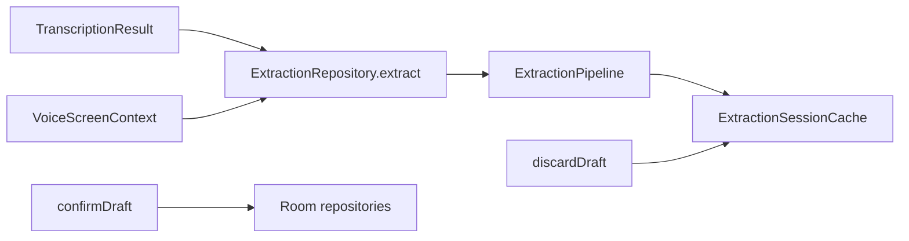

# Extração heurística Banavita (backend)

Classifica/extrai slots a partir do transcript ASR, com **contexto de tela conhecido**. Rascunho e texto ficam **somente em memória**; o Room só é escrito após `confirmDraft`.

## Por que não MediaPipe nesta etapa

| MediaPipe Text | Banavita |
|-----------------|----------|
| Text Classifier | Redundante: a tela já define Venda/Compra/Cliente |
| Language Detector | ASR já força `pt` |
| Text Embedder | Evolução futura para fuzzy match |
| NER / slot-filling | **Não existe** pronto |

Abordagem atual: **heurísticas PT-BR + dicionário + match no cadastro local**.

## Fluxo



1. `extract(transcript, context)` → parsers + `EntityResolver`
2. `ExtractionDraft` em `ExtractionSessionCache` (RAM)
3. UI futura mostra modal; usuário confirma ou edita
4. `confirmDraft(id)` grava via repositórios existentes e limpa o cache
5. `discardDraft(id)` só limpa a sessão

**Transcript nunca vai para SQLite.**

## Contextos

| Contexto | Slots principais | Resolução DB |
|----------|------------------|--------------|
| VENDA | produto, qtde, unidade, preço?, cliente? | produtoId, clienteId |
| COMPRA | produto, qtde, unidade, preço, fornecedor? | produtoId, fornecedorId |
| CLIENTE | nome, telefone? | — |
| FORNECEDOR | nome, telefone? | — |
| PRODUTO | descrição, preço, unidade, grupo? | grupoId |
| GRUPO | nome, observação? | — |

## API

```kotlin
suspend fun extract(transcript: String, context: VoiceScreenContext): ExtractionDraft
suspend fun extractFromTranscription(transcription: TranscriptionResult, context: VoiceScreenContext): ExtractionDraft
fun getCurrentDraft(): ExtractionDraft?
suspend fun confirmDraft(draftId: UUID): ConfirmResult
fun discardDraft(draftId: UUID)
```

## Pacotes

| Camada | Pacote |
|--------|--------|
| Parsers / resolver | `br.com.banavita.app.core.extraction` |
| Modelos | `br.com.banavita.app.domain.model.extraction` |
| Cache | `br.com.banavita.app.data.cache.ExtractionSessionCache` |
| Repositório | `br.com.banavita.app.data.repository.ExtractionRepository` |

## Exemplos

Venda:

> “vende três quilos de banana nanica pra Maria a doze reais”

→ qtde `3`, unidade `KG`, produto `banana nanica`, cliente `Maria`, preço `1200` centavos.

## Evolução

- MediaPipe Text Embedder para similaridade de nomes ambíguos
- Multi-itens na mesma fala
- Fine-tune / LLM só se heurísticas saturarem
