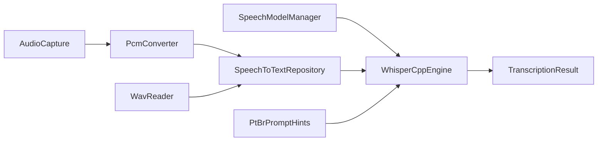

# ASR offline Banavita (whisper.cpp / PT-BR)

Transcrição de voz **100% local** com whisper.cpp + modelo GGML quantizado. Idioma forçado: **português (`pt`)**. Sem telas nesta etapa — apenas backend.

## Pipeline



1. Áudio PCM 16 kHz mono (microfone ou WAV).
2. Conversão para `FloatArray` em `[-1, 1]`.
3. Limite de **15 s** por request.
4. Inferência whisper.cpp (`language=pt` + `initial_prompt`).
5. Normalização lexical leve (ex.: `caxinha` → `caixinha`).

## Modelo ativo

| Item | Valor |
|------|--------|
| ID | `ggml-base-q5_1` |
| Arquivo | `ggml-base-q5_1.bin` (~57 MB) |
| Perfil | `MINIMUM` (Galaxy A17 8 GB+) |
| SHA-256 | `422f1ae452ade6f30a004d7e5c6a43195e4433bc370bf23fac9cc591f01a8898` |
| Distribuição | Sidecar em `filesDir/models/` (não vai no APK) |

Perfis **INTERMEDIATE** / **PREMIUM** existem no `SpeechModelCatalog` como reservados (sem download automático).

## Sotaque interior paulista (caipira)

Não há modelo Whisper público treinado em sotaque caipira. Adaptação atual:

1. **`PtBrPromptHints.initialPrompt`** — viés lexical (banana, caixinha, quilo, dúzia, venda, compra…).
2. **Tabela de correções** pós-transcrição.
3. Evolução futura: corpus regional + fine-tune (fora do escopo).

## API (`SpeechToTextRepository`)

```kotlin
ensureModelReady(): ModelStatus
prepareEngine()                       // carrega GGML se necessário
transcribe(pcm16kMono: FloatArray): TranscriptionResult
transcribeWav(file: File): TranscriptionResult
transcribeMicrophone(seconds: Int): TranscriptionResult
release()
```

`TranscriptionResult`: `text`, `language`, `durationMillis`, `modelId`.

## Nativo

- Biblioteca: `libbanavita_whisper.so` (arm64-v8a)
- Fonte: whisper.cpp **v1.7.6** via CMake FetchContent
- JNI: `WhisperLib` → dispatcher single-thread `whisper-inference`
- Build: NDK + CMake 3.22+ no [app/build.gradle.kts](../../app/build.gradle.kts)

## Instalação do modelo

Ver [tools/speech-model/README.md](../../tools/speech-model/README.md).

```bash
cd tools/speech-model
npm run download
# depois adb push / run-as conforme o README da ferramenta
```

## Exceções

| Tipo | Quando |
|------|--------|
| `SpeechModelException` | Modelo ausente / checksum inválido |
| `SpeechEngineException` | Falha nativa whisper |
| `SpeechAudioException` | Microfone/WAV inválido |

## Limites desta etapa

- Sem UI de microfone.
- Sem classificação de venda/compra a partir do texto.
- Sem streaming parcial (batch: grava → transcreve).
- Só `arm64-v8a`.
