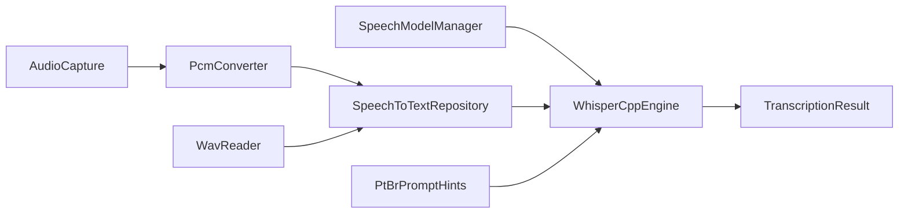

# ASR offline Banavita (whisper.cpp / PT-BR)

Transcrição de voz **100% local** com whisper.cpp + modelo GGML quantizado. Idioma forçado: **português (`pt`)**.

## Pipeline



1. Áudio PCM 16 kHz mono (segurar o mic até soltar, ou WAV).
2. Conversão para `FloatArray` em `[-1, 1]`.
3. Limite de **15 s** por request (a captura para sozinha nesse teto).
4. Inferência whisper.cpp (`language=pt` + `initial_prompt`).
5. Normalização lexical leve (ex.: `caxinha` → `caixinha`).

## Modelo ativo

| Item | Valor |
|------|--------|
| ID | `ggml-base-q5_1` |
| Arquivo | `ggml-base-q5_1.bin` (~57 MB) |
| Perfil | `MINIMUM` (Galaxy A17 8 GB+) |
| SHA-256 | `422f1ae452ade6f30a004d7e5c6a43195e4433bc370bf23fac9cc591f01a8898` |
| Distribuição | **Embutido no APK** (`assets/models/`) |

Perfis **INTERMEDIATE** / **PREMIUM** existem no `SpeechModelCatalog` como reservados (sem download automático).

## Extração no aparelho (e por que a pasta USB `data` parece vazia)

O `.bin` **não** é baixado pelo celular e **não** vai para o armazenamento que o cabo USB (MTP) mostra. Pipeline:

```
PC: cd tools/speech-model && npm run download
  → tools/speech-model/models/ggml-base-q5_1.bin
  → Gradle (preBuild) copia para app/src/main/assets/models/
  → APK: assets/models/ggml-base-q5_1.bin
  → 1ª tela com mic: SpeechModelManager copia para o armazenamento privado
```

Caminho no dispositivo (só o app enxerga):

```
/data/data/br.com.banavita.app/files/models/ggml-base-q5_1.bin
```

A cópia valida tamanho mínimo e SHA-256. Se o arquivo local estiver ausente ou corrompido, a extração dos assets se repete.

**Pasta `data` vazia no explorador do Windows:** esperado. O MTP mostra armazenamento compartilhado (`Download`, etc.), não `/data/data/<pacote>/`. Isso **não** prova que o modelo faltou no APK. A pasta `files/models/` só existe depois da primeira abertura de uma tela com microfone (pré-aquecimento) ou da primeira gravação.

### Conferir sem `adb` (recomendado)

1. Celular no cabo, depuração USB autorizada, Banavita **debug** instalado.
2. Android Studio: **View → Tool Windows → Device File Explorer**.
3. Abra `data/data/br.com.banavita.app/files/models/`.
4. Deve aparecer `ggml-base-q5_1.bin` (~57 MB).

Se `models` não existir, abra no app uma tela com o botão de voz (Início, lista ou formulário novo) e atualize o explorer.

**Logcat** (Android Studio: **View → Tool Windows → Logcat**, filtro `BanavitaSpeech`):

```
Modelo ASR extraído em /data/data/br.com.banavita.app/files/models/ggml-base-q5_1.bin
```

Essa linha aparece na extração (primeira vez ou reinstalação do arquivo). Build **release** não permite Device File Explorer / `run-as` da mesma forma.

### Conferir com `adb`

O `adb` vem do Android SDK (`platform-tools`). O **Git Bash** no Windows **não** inclui esse PATH: `adb: command not found` / “não é reconhecido” é normal se você não configurou o SDK no PATH.

**Opção A — Terminal do Android Studio** (**View → Tool Windows → Terminal**), com o celular em `adb devices` como `device`:

```bash
adb devices
adb shell run-as br.com.banavita.app ls -la files/models
```

**Opção B — Git Bash com o caminho completo** (troque `SEU_USUARIO` pelo usuário do Windows):

```bash
ADB="/c/Users/SEU_USUARIO/AppData/Local/Android/Sdk/platform-tools/adb.exe"

"$ADB" devices
"$ADB" shell run-as br.com.banavita.app ls -la files/models
```

Caminho típico no Explorer: `C:\Users\SEU_USUARIO\AppData\Local\Android\Sdk\platform-tools\adb.exe`. Se o SDK estiver em outra pasta: Android Studio → **File → Settings → Languages & Frameworks → Android SDK** → **Android SDK Location**.

Pré-requisitos do `run-as`: APK **debug**, cabo de **dados**, depuração USB, aparelho autorizado. `adb devices` deve listar o Galaxy (ou o emulador) como `device`, não `unauthorized`.

## Build do APK

Antes do primeiro build (ou ao atualizar o modelo):

```bash
cd tools/speech-model
npm run download
```

Isso baixa o `.bin`, grava checksums e copia para `app/src/main/assets/models/`. O Gradle também executa `copySpeechModelToAssets` no `preBuild`.

Build normal:

```bash
./gradlew assembleDebug
```

Build sem modelo (só desenvolvimento de UI, voz indisponível):

```bash
./gradlew assembleDebug -PskipSpeechModel
```

Detalhes em [tools/speech-model/README.md](../../tools/speech-model/README.md).

## Sotaque interior paulista (caipira)

Não há modelo Whisper público treinado em sotaque caipira. Adaptação atual:

1. **`PtBrPromptHints.initialPrompt`** — viés lexical (banana, caixinha, quilo, dúzia, venda, compra…).
2. **Tabela de correções** pós-transcrição.
3. Evolução futura: corpus regional + fine-tune (fora do escopo).

## API (`SpeechToTextRepository`)

```kotlin
ensureModelReady(): ModelStatus
prepareEngine()                       // extrai GGML + carrega whisper se necessário
transcribe(pcm16kMono: FloatArray): TranscriptionResult
transcribeWav(file: File): TranscriptionResult
release()
```

Captura ao vivo: `AudioCapture.start()` / `stop()` (IO, RMS para a barra) enquanto o usuário **segura** o mic; ao soltar o ViewModel chama `transcribe(samples)`.

`TranscriptionResult`: `text`, `language`, `durationMillis`, `modelId`.

## Nativo

- Biblioteca: `libbanavita_whisper.so` (arm64-v8a)
- Fonte: whisper.cpp **v1.7.6** via CMake FetchContent
- JNI: `WhisperLib` → dispatcher single-thread `whisper-inference`
- Build: NDK + CMake 3.22+ no [app/build.gradle.kts](../../app/build.gradle.kts)

## Exceções

| Tipo | Quando |
|------|--------|
| `SpeechModelException` | Modelo ausente / checksum inválido |
| `SpeechEngineException` | Falha nativa whisper |
| `SpeechAudioException` | Microfone/WAV inválido |

## UX de captura

Ordem na tela (mockups): [voice-recording](../ui/mockups/voice-recording.png) → [voice-transcribing](../ui/mockups/voice-transcribing.png) → [voice-review-sheet](../ui/mockups/voice-review-sheet.png).

- Segurar o botão do mic grava; soltar transcreve (máx. 15 s).
- Toque curto (< 400 ms): aviso para segurar, sem Whisper.
- Enquanto segura: barra com timer `m:ss` e intensidade (RMS).
- Ao soltar: overlay com spinner **Transcrevendo…**, depois a ficha de revisão.

## Limites

- Sem streaming parcial (batch: grava → transcreve).
- Só `arm64-v8a`.
